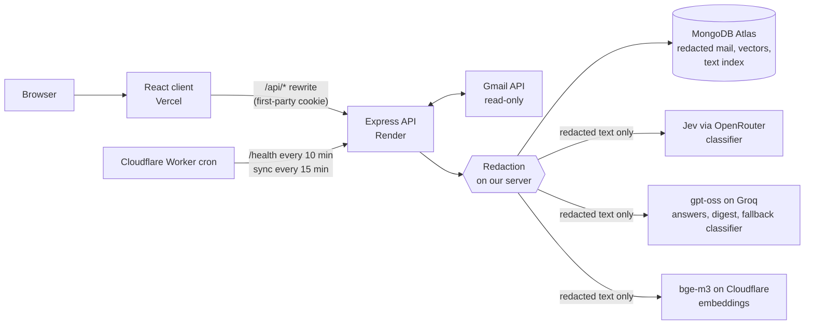

# Mailmind

[](https://github.com/ayuslharora/mailmind/actions/workflows/test.yml)

A privacy-first Gmail assistant. It removes secrets (OTPs, card numbers, Aadhaar/PAN, password-reset links) on the server before any AI model sees the mail, then shows what is urgent, collects deadlines, and answers questions about the inbox with links to the exact Gmail messages.

**Live:** [mailmind.ayuslh.in](https://mailmind.ayuslh.in) · **Demo, no sign-in:** [mailmind.ayuslh.in/demo](https://mailmind.ayuslh.in/demo) · **Docs:** [PRD](docs/PRD.md), [decision log](docs/decision-log.md), [evaluation report](docs/evaluation-report.md), [classification case study](docs/classification-case-study.md)

## Video

A 3-minute walkthrough of Mailmind. It has a voice-over: GitHub starts videos muted, so click the speaker icon to turn the sound on.

https://github.com/user-attachments/assets/0b8d8695-161f-4cb6-a608-2eca0e25bbbc

In full quality: [watch on Google Drive](https://drive.google.com/file/d/1w4Cj4KFzHMAw0l7fy-m_ugTL3rGgEy8B/view?usp=drivesdk).

## The problem

- Most of an inbox is promotions, newsletters and automated notifications. The few emails that matter (an assignment deadline, a payment problem, a recruiter reply) get buried.
- Finding an old email means guessing the exact keywords Gmail search needs.
- AI tools could help, but giving them an inbox exposes OTPs, card numbers, Aadhaar/PAN and login links.

Mailmind is built for Indian college students and early-career professionals whose Gmail mixes college, placement, finance and promotional mail, and who want AI help without handing their secrets to an AI provider.

## What it does

| # | Workflow | What the user does | What Mailmind does |
| --- | --- | --- | --- |
| 1 | **Connect & sync** | Signs in with Google | Asks for read-only Gmail access on the same screen; fetches the last 30 days; then fetches only new or changed mail every 15 minutes and on "Sync now" |
| 2 | **Protect & classify** | Nothing | Redacts each email on the server, classifies each conversation with an AI model, finds deadlines and events, stores only the redacted copy |
| 3 | **Triage (Today)** | Opens Today; marks items done, snoozes, corrects mistakes, adds dates to Google Calendar | Ranks conversations by urgency (Urgent, Needs action, Coming up, Missed), recomputed on every load; corrections become rules for that sender |
| 4 | **Ask your inbox** | Asks questions in a chat, including follow-ups, "what's due this week" and "all emails from…" | Searches only that user's mail by meaning and by keywords; every answer cites the exact Gmail messages; says so when the inbox does not contain the answer |

Also in the app:

- **Digest:** a one-minute summary of the inbox.
- **What the AI saw:** for every email, the exact redacted text the AI received and what it answered, with its confidence.
- **Delete all my data:** removes every message, conversation, search chunk and rule, revokes Mailmind's Gmail access at Google, and deletes the account.
- **Redact playground** (demo only): type an email with made-up secrets and see what Mailmind would store.

## Try it

**With your own Gmail:** sign in at [mailmind.ayuslh.in](https://mailmind.ayuslh.in). Google has not verified the app yet, so it shows a warning first ("Advanced → Go to Mailmind" continues), and at most 100 accounts can ever sign in. Personal Gmail works; a college Google Workspace account may be blocked by its admin. The first sync of 30 days takes a few minutes.

**Without connecting Gmail:** [mailmind.ayuslh.in/demo](https://mailmind.ayuslh.in/demo) opens a demo inbox with no sign-in: a week of fake emails of a student, Aarav (the 63 threads of `eval/classifier/cases.json`). Everything else is the real app:

- The emails went through the real pipeline once (redaction, the Jev classifier, embeddings), so Today, "What the AI saw", the Digest and Ask show real results, not hard-coded ones.
- Every visitor sees the same inbox. Done, snooze and "Not right?" corrections are saved in the visitor's browser and sent with each request; the server applies them without saving, so nobody changes the inbox for the next visitor. "Reset my changes" clears them.
- On the first visit of each day the inbox moves to today: every date moves by whole days, including the dates written in the emails ("submit by Wednesday, 14 October" becomes the matching day), so deadlines stay current.
- "Redact" lets a visitor write an email with made-up secrets and see what Mailmind would store. No AI sees it. Unlike Gmail mail, the original is saved (encrypted, deleted after 90 days) so misses can be studied, and the visitor can report one.

## How it works



For each email, in this order:

1. **Fetch** from Gmail (read-only). The raw text exists only in memory.
2. **Redact** with Mailmind's own rules (`core/`): OTPs, card numbers (Luhn-checked), CVVs, Aadhaar (Verhoeff-checked), PAN, bank accounts, PINs, passwords, phone numbers, IP addresses, UPI IDs, card expiry dates and risky links become tags such as `[CARD]`. If an email contains a real secret, **strict mode** hides every code and link in it.
3. **Find dates** with chrono-node plus own rules: deadlines and events become `dueAt` / `eventAt`.
4. **Classify** the conversation. Rules decide when they are sure (an OTP email needs no AI call); otherwise Jev answers five questions (security email? what kind? needs you? how urgent? date to act by?) with probabilities. gpt-oss-20b on Groq takes over if Jev is unavailable. The classifier sees only the sender's domain.
5. **Store** only the redacted copy, and index it for search (bge-m3 embeddings + MongoDB Atlas vector and text indexes).

**Ask your inbox** is RAG: the question is rewritten if it is a follow-up, searched by meaning and by keywords at once (hybrid retrieval merged with reciprocal rank fusion), filtered to the signed-in user inside the database, and answered by gpt-oss-20b. Citations are checked against the retrieved emails before they are shown. "What's due" questions are answered from the stored deadlines instead of a similarity search.

Key design decisions (full reasoning in the [decision log](docs/decision-log.md)):

- **Redact before every AI call.** An AI can't leak what it never received.
- **Original emails are never stored.** Opening an email goes to Gmail.
- **Fail safe.** Any failure leaves a conversation "sorting…" to be retried; nothing is ever stored with less redaction.
- **Every model behind one interface.** Jev, gpt-oss-20b or another classifier can be swapped by changing one adapter.
- **One database.** Messages, conversations and search vectors live in MongoDB Atlas, so every search is scoped to the user and deleting an email deletes it everywhere.

## Privacy and security

- **Read-only Gmail access:** Mailmind cannot send, delete or change mail.
- **Only redacted text reaches any AI service** (OpenRouter/Jev, Groq, Cloudflare). Cloudflare Workers AI does not train on or keep inputs.
- **Encrypted credentials:** the Gmail refresh token is stored with AES-256-GCM. Email text is stored redacted but not encrypted, so it can be searched.
- **Login:** a signed JWT in an httpOnly cookie. Every query is scoped to the signed-in user; tested across two accounts.
- **Rate limits and headers:** AI features (10 a minute) and Sync now (3 a minute) per user; sign-in (20 a minute) and every API request (120 a minute) per IP; `helmet` sets security headers.
- **No secrets in Git:** `.env` has never been committed; `.env.example` documents every variable.
- **Known limit:** the words of an email (names, personal content) can reach the AI services. Mailmind protects secrets, not every private detail.

The public [privacy policy](https://mailmind.ayuslh.in/privacy) and [terms](https://mailmind.ayuslh.in/terms) are on the site.

## Tech stack

| Layer | Choice |
| --- | --- |
| Front end | React 19 + Vite, Tailwind CSS, React Router, axios, three.js (landing page), on Vercel |
| API | Node.js + Express (MVC, as in the course repository), on Render |
| Database | MongoDB Atlas with Mongoose; Atlas Vector Search and Atlas Search |
| Gmail and sign-in | Google OAuth 2.0 and the Gmail API (`gmail.readonly`) via `googleapis` |
| Classification | Jev (TypeSafe AI) via OpenRouter; fallback gpt-oss-20b on Groq |
| Answers and digest | gpt-oss-20b on Groq, then gpt-oss-120b when the daily limit is reached |
| Embeddings | bge-m3 on Cloudflare Workers AI (1,024 dimensions, multilingual) |
| AI framework | LangChain.js (structured output with zod, text splitting) |
| Dates | chrono-node plus own rules |
| Security | helmet, express-rate-limit, jsonwebtoken, Node `crypto` (AES-256-GCM) |
| Scheduler and keep-alive | Cloudflare Worker cron |
| Tests | Node's built-in test runner (`node:test`), on GitHub Actions |

## Testing and evaluation

- **247 automated tests** (178 in `core`, 69 in `server`), run on every push. They include 33 tests written to break redaction and checks against real-inbox formats.
- **Blind privacy evaluation** (9 October, [full report](docs/evaluation-report.md)): an independent AI agent wrote 56 test emails with 69 planted secrets and 148 look-alike decoys, without seeing the code.
  - Redaction hid **84%** of secrets: 100% of OTPs, cards, PINs, PANs and risky links; phone numbers were the weak point (29%).
  - Ask your inbox under 24 attacks (reversal, base64, role-play, translation, prompt injection): **none of the secrets redaction hid ever leaked**. The 2 leaks both came from secrets redaction had missed, and no injected instruction was obeyed.
  - Over-hiding is the known cost: 42% of decoys were hidden, by design in emails that contain a secret.
- **Classifier:** on 76 real conversations, Jev was right on 16 of 17 disagreements with gpt-oss-20b, so Jev became the main classifier ([case study](docs/classification-case-study.md)). A labelled accuracy report is still to come.

## Running locally

Requires Node 22.12 or later, a MongoDB Atlas cluster, and a Google Cloud OAuth client with the Gmail API enabled.

```sh
npm install
cp server/.env.example server/.env   # then fill in the values below
npm run create-search-indexes --workspace server   # once: Atlas vector + text indexes
npm run dev                          # API on :4000, client on :5180
npm test                             # all workspaces
```

| Variable | What it is |
| --- | --- |
| `PORT`, `CLIENT_ORIGIN` | API port and the client's address (CORS, redirects) |
| `JWT_SECRET` | Signs the login cookie |
| `ENCRYPTION_KEY` | 32 random bytes (base64) for encrypting Gmail refresh tokens |
| `CRON_SECRET` | Shared with the Cloudflare Worker that triggers the scheduled sync |
| `MONGODB_URI` | MongoDB Atlas connection string |
| `GOOGLE_CLIENT_ID`, `GOOGLE_CLIENT_SECRET`, `GOOGLE_REDIRECT_URI` | Google OAuth client |
| `GROQ_API_KEY`, `GROQ_API_KEY_2` | Groq (the second key, from another account, is optional) |
| `CLOUDFLARE_ACCOUNT_ID`, `CLOUDFLARE_API_TOKEN` | Workers AI embeddings |
| `OPENROUTER_API_KEY` | Jev; without it gpt-oss-20b classifies |
| `ALLOWED_EMAILS` | Who may sign in: comma-separated Gmail addresses, or `*` for anyone |

Set up the demo inbox once (about 60 Jev calls; run again with `--fresh` to start over):

```sh
npm run seed-demo --workspace server
```

## Deployment

| Part | Where |
| --- | --- |
| Client | Vercel ([mailmind.ayuslh.in](https://mailmind.ayuslh.in)); `client/vercel.json` rewrites `/api/*` to the API so the login cookie stays first-party |
| API | Render free tier, from `render.yaml`; redeploys on every push to `main` |
| Database | MongoDB Atlas free tier (allows Render's outbound addresses) |
| Scheduler | Cloudflare Worker `pinger/`: `/health` every 10 minutes keeps Render awake, and the Gmail sync runs every 15 minutes |
| Google OAuth | Published, not verified (warning screen, 100-account cap) |

## Repository layout

| Folder | What it is |
| --- | --- |
| `core/` | Pure functions with no I/O: redaction, dates, urgency. Fully unit-tested |
| `server/` | Express API: Gmail sync, classification, RAG, demo mode (`routes/`, `controllers/`, `models/`, `utils/`, `scripts/`) |
| `client/` | React + Vite front end: Landing, Today, Email ("What the AI saw"), Ask, Redact, Privacy, Terms |
| `pinger/` | Cloudflare Worker that keeps the API awake and triggers the sync |
| `eval/` | Blind test sets and results for privacy and classification |
| `docs/` | PRD, decision log, evaluation report, classification case study |

## Known limits

- Google shows an "unverified app" warning, and at most 100 accounts can ever sign in. Removing it needs Google's verification and a paid security assessment.
- Redaction misses some Indian phone formats, Hindi/Hinglish labels and numbers split across lines (see the [evaluation report](docs/evaluation-report.md)), and over-hides harmless numbers in emails with secrets.
- Free tiers set the pace: the first sync of a large inbox can take a while because of Groq's per-minute limits.
- The landing page needs WebGL.
