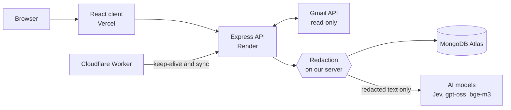

# Mailmind

[](https://github.com/ayuslharora/mailmind/actions/workflows/test.yml)

A privacy-first Gmail assistant. It removes secrets (OTPs, card numbers, Aadhaar/PAN, login links) on the server before any AI sees the mail, then shows what is urgent, collects deadlines, and answers questions about the inbox with links to the source emails.

**Live:** [mailmind.ayuslh.in](https://mailmind.ayuslh.in) · **Demo, no sign-in:** [mailmind.ayuslh.in/demo](https://mailmind.ayuslh.in/demo)

## Video

A 3-minute walkthrough with a voice-over. GitHub starts videos muted, so click the speaker icon to turn the sound on.

https://github.com/user-attachments/assets/0b8d8695-161f-4cb6-a608-2eca0e25bbbc

In full quality: [watch on Google Drive](https://drive.google.com/file/d/1w4Cj4KFzHMAw0l7fy-m_ugTL3rGgEy8B/view?usp=drivesdk).

## The problem

Important emails (a deadline, a payment problem, a recruiter reply) get buried under promotions and notifications. AI could help sort them, but handing an inbox to an AI exposes OTPs, card numbers and other secrets. Mailmind is built for Indian students and early-career professionals who want that help without the risk.

## What it does

| Workflow | What happens |
| --- | --- |
| **Connect & sync** | Sign in with Google (read-only Gmail access). Mailmind fetches the last 30 days, then new mail every 15 minutes |
| **Protect & classify** | Each email is redacted on the server, then an AI sorts it and finds its deadlines. Only the redacted copy is stored |
| **Today** | What needs you, ranked: Urgent, Needs action, Coming up, Missed. Mark done, snooze, correct mistakes, add to Google Calendar |
| **Ask your inbox** | Ask questions in plain words ("what's due this week?"); answers link to the exact emails |

Also: a daily **Digest**, a **"What the AI saw"** page for every email, and **Delete all my data** in one click.

## Try it

- **Your own Gmail:** sign in at [mailmind.ayuslh.in](https://mailmind.ayuslh.in). Google hasn't verified the app yet, so click "Advanced → Go to Mailmind" on the warning screen.
- **No sign-in:** [mailmind.ayuslh.in/demo](https://mailmind.ayuslh.in/demo) opens a demo inbox of fake emails that went through the real pipeline. It also has a **Redact** page where you can type an email with made-up secrets and see what Mailmind would hide.

## How it works



1. **Fetch** an email from Gmail. The original text stays in memory only.
2. **Redact** it with Mailmind's own rules: OTPs, cards, CVVs, Aadhaar, PAN, bank accounts, passwords, phone numbers and risky links become tags such as `[CARD]`.
3. **Classify** it: simple cases by rules, the rest by Jev (with gpt-oss-20b as a fallback). Deadlines and events are read from the text.
4. **Store** only the redacted copy and index it for search.

**Ask your inbox** searches your mail by meaning and by keywords, then answers with gpt-oss-20b and cites the emails it used.

## Privacy and security

- Gmail access is read-only, and only redacted text ever reaches an AI service.
- Original emails are never stored; the Gmail login token is encrypted (AES-256-GCM).
- Each user can only see their own data, with rate limits and security headers on the API.
- No secrets in the repository: `.env` has never been committed.

Full policy: [mailmind.ayuslh.in/privacy](https://mailmind.ayuslh.in/privacy).

## Tech stack

| Layer | Choice |
| --- | --- |
| Front end | React + Vite, Tailwind CSS (Vercel) |
| Back end | Node.js + Express (Render) |
| Database | MongoDB Atlas, with vector and text search |
| AI | Jev via OpenRouter (classification), gpt-oss on Groq (answers), bge-m3 on Cloudflare (search) |
| Other | Gmail API, LangChain.js, chrono-node, Cloudflare Worker (scheduler) |

## Testing

- **247 automated tests**, run on every push with GitHub Actions.
- **Blind privacy test:** an independent AI wrote test emails with planted secrets, without seeing the code. Redaction hid about 85% of them, and no secret that was hidden ever leaked through Ask your inbox, even under deliberate attacks. Details: [evaluation report](docs/evaluation-report.md).

## Running locally

Requires Node 22.12+, a MongoDB Atlas cluster and a Google OAuth client with the Gmail API enabled.

```sh
npm install
cp server/.env.example server/.env   # fill in the values; each is explained in the file
npm run create-search-indexes --workspace server
npm run dev                          # API on :4000, client on :5180
npm test
```

## Project structure

| Folder | Contents |
| --- | --- |
| `core/` | Redaction, date and urgency rules (no I/O, fully tested) |
| `server/` | Express API |
| `client/` | React front end |
| `pinger/` | Cloudflare Worker: keeps the API awake and runs the sync |
| `eval/` | Test sets for the evaluation |
| `docs/` | [PRD](docs/PRD.md), [decision log](docs/decision-log.md), [evaluation report](docs/evaluation-report.md), [classification case study](docs/classification-case-study.md) |

## Known limits

- Google shows an "unverified app" warning, and at most 100 accounts can sign in.
- Redaction misses some phone number formats and Hindi labels, and sometimes hides harmless numbers.
- Free hosting tiers make the first sync of a large inbox slow.
